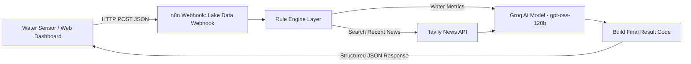

# India Lake AI Water Quality Monitor

An IoT telemetry and AI diagnostic project powered by **Google Antigravity** and an **n8n Workflow** (`India Lake AI Diagnosis (Groq)` - ID: `CL6bCFtadsf0kmLX`).

---

## 🌊 System Architecture



1. **Telemetry Ingestion**: Receives water quality sensor readings (`pH`, `dissolved_oxygen`, `TDS`, `turbidity`, `temperature`).
2. **Rule Engine**: Evaluates thresholds against Central Pollution Control Board (CPCB) and Bureau of Indian Standards (BIS) norms.
3. **News Search**: Fetches recent local news articles regarding lake pollution in the area via Tavily.
4. **Groq AI Diagnosis**: Synthesizes the telemetry with local context to determine root causes, prioritize immediate/short-term/long-term recovery actions, and identify regulatory bodies to notify.

---

## 🚀 Quickstart

### Option 1: Open the Interactive Web Dashboard
Simply open [`index.html`](file:///C:/Users/USER/.gemini/antigravity/scratch/india-lake-ai-monitor/index.html) in your browser:
* Pre-configured with presets for **Bellandur Lake**, **Powai Lake**, **Hussain Sagar**, and **Dal Lake**.
* Interactive sliders to simulate changing water conditions.
* Real-time diagnosis reports with score gauges and action checklists.

### Option 2: Run the Python CLI & Telemetry Simulator
```bash
python lake_monitor.py
```
Select a preset lake scenario or enter custom sensor readings to trigger the live n8n workflow and view the formatted diagnostic report.

---

## ⚙️ Connected Endpoints

* **n8n Production Webhook**: `https://supermanxo777.app.n8n.cloud/webhook/india-lake-monitor-ai`
* **n8n MCP Server**: `https://supermanxo777.app.n8n.cloud/mcp-server/http`
* **Workflow ID**: `CL6bCFtadsf0kmLX`
